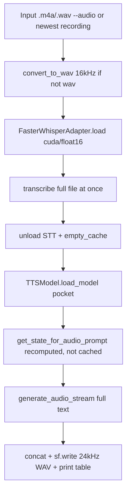
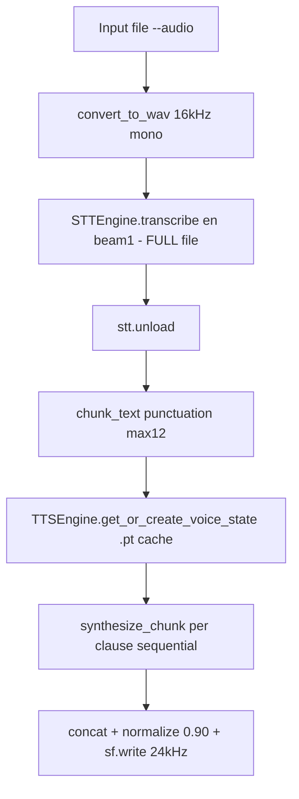
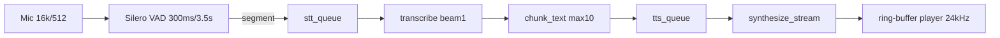

# Technical Handoff — TTS POC → Audio Cascader

> **Stale (2026-10-17): historical pre-simplification audit.** The active
> application is now `app.py` + `web/index.html`; this document describes the
> Gen-1/Gen-2 hybrid it replaced. Kept for reference; the full old tree is
> recoverable from the freeze commit.

> Audience: an independent reviewing AI with **no filesystem access** and no prior conversation.
> Scope: documentation and investigation only. No code was changed to produce this file.
> Claim labels used throughout: `Verified` (read in source or measured this session),
> `Partially verified` (code read but runtime not observed), `Unverified` (needs external check).
> All paths below are **relative to the stated project root** unless marked absolute.
> Absolute roots: original `C:\47B\tts-poc`, rebuilt `C:\47B\Audio Cascader`.

---

## 1. Project overview

### Purpose

- **Original `tts-poc`** (`Verified` from `README.md`, `docs/`, `PROJECT_REPORT.md`):
  A broad **14-model TTS evaluation platform + S2S voice/accent conversion POC**.
  Two jobs: (a) benchmark open TTS models (Kokoro, StyleTTS2, CosyVoice 2/3, F5-TTS,
  Piper, Qwen3-TTS, Chatterbox, XTTS-v2, Orpheus, MegaTTS3, Dia2, VibeVoice, Fish S2)
  on an RTX 3050 6 GB laptop; (b) convert spoken input (`.m4a`/`.wav`) via
  Faster-Whisper STT → Pocket TTS / StyleTTS2 voice cloning, in batch and in
  real-time live-mic mode with Silero VAD.
- **Rebuilt `Audio Cascader`** (`Verified` from `pipeline.py:1-5`, `gui.py:1-5`,
  `core/*.py` docstrings): a **simplified single-engine S2S converter**:
  Indian-English audio in → Faster-Whisper Turbo STT → punctuation chunker →
  Kyutai Pocket TTS with one cached American-accent voice → American-accented WAV out.
  Two front ends share the same core: file/batch mode (`pipeline.py`) and
  Tkinter desktop GUI with File tab + Live-mic tab (`gui.py`, `run_gui.bat`).

### Intended differences

Per the rebuild brief: keep only **three logical components**
(STT → punctuation chunker → TTS), pin **Whisper Turbo on GPU** and
**Pocket TTS on GPU**, keep input Indian English verbatim and change only the
accent to a natural non-robotic American accent, and persist cloned-voice
embeddings to disk. Everything else (13 other TTS engines, Streamlit eval app,
cloud recipes, multi-engine CLI flags) was to be dropped.

### Actual architecture implemented

- `tts-poc` (`Verified`): modular multi-engine app.
  `scripts/pipeline.py` (4 stages) + `scripts/live_engine.py` + `scripts/live_s2s.py`
  + `scripts/gui_app.py` + `app/` (Streamlit eval suite: config/registry/inference/
  benchmark/scoring) + `models/stt/faster_whisper/adapter.py` + `tts/` adapters
  (incl. `tts/pocket.py`) + `translate/` (older streaming mic→STT→coordinator→TTS
  pipeline driven by `.env`) + `scripts/utils/` (audio_convert, audio_stream).
  Engine source vendored at `DNXS-Spokenword-Pocket-TTS-GPU/pocket_tts/`.
- `Audio Cascader` (`Verified`): slimmed to one STT + one TTS engine.
  `core/stt_engine.py` (Faster-Whisper wrapper), `core/tts_engine.py` (Pocket TTS
  wrapper + `.pt` voice cache), `core/chunker.py` (punctuation splitter),
  `core/audio_convert.py` (decode/resample), `core/audio_stream.py`
  (mic capture / Silero VAD segmenter / playback). `pipeline.py` = 5-step
  file mode; `gui.py` = file mode + concurrent live mode (3 worker threads).
  Engine source vendored at `pocket_tts/` (same Kyutai fork).

### Entry points / exact run commands

| Project | Entry | Command (`Verified` from source; runtime not re-executed here) |
|---|---|---|
| tts-poc batch | `pipeline.py` (root shim → `DNXS-…/.venv/Scripts/python.exe` → `scripts/pipeline.py:main`) | `python pipeline.py --audio "Testinput\Anoop voice line.wav" --reference "Testinput\american accent.wav" [--stt-model turbo] [--tts-engine pocket_tts\|styletts2]`; `--select`, `--live`, `--list-devices` also supported (`scripts/pipeline.py:142-251`) |
| tts-poc live | `scripts/live_s2s.py:main` → `scripts/live_engine.py:LiveS2SEngine` | `python scripts/live_s2s.py --reference "Testinput\american accent.wav" [--stt-model tiny\|turbo]` |
| tts-poc GUI | `gui.py` / `gui.pyw` → `scripts/gui_app.py` | `python gui.py` |
| tts-poc eval UI | `app/main.py` | `streamlit run app\main.py` (`docs/installation.md`) |
| Cascader file | `pipeline.py:main` → `run_pipeline` | `python pipeline.py --audio <in.wav|.m4a|.mp3> [--output out.wav] [--device cuda|cpu] [--play]` (`pipeline.py:151-164`) |
| Cascader GUI | `gui.py:main` via `run_gui.bat` (`.venv\Scripts\python.exe gui.py`) | Double-click `run_gui.bat` or `python gui.py`; File tab calls `pipeline.run_pipeline`, Live tab runs capture→VAD→STT→TTS threads (`gui.py:296-411`) |

Python runtime `Verified`: Cascader `.venv` = **Python 3.12.5, torch 2.6.0+cu124,
CUDA available, RTX 3050 6GB Laptop GPU** (probed via `.venv\Scripts\python.exe`).
System-global python is 3.14.5 **without** `faster_whisper`/`ctranslate2` — the
`.venv` must be used. tts-poc instead redirects to
`DNXS-Spokenword-Pocket-TTS-GPU/.venv`.

### Retained / removed / simplified / introduced

- Retained (`Verified`): PyAV→16 kHz mono conversion; Faster-Whisper CTranslate2
  inference; Pocket TTS `generate_audio_stream(copy_state=True)`; Silero VAD
  (0.5 / 300 ms / 3.5 s) + 16 kHz/512 capture + 24 kHz/1024 playback ring buffer;
  VRAM isolation (`stt.unload()` + `empty_cache`); latency logging
  (STT / TTFB / glass-to-glass); Tkinter GUI with device pickers and VU meters.
- Removed (`Verified` by absence in Cascader tree): 13 alternate TTS engines,
  `app/` Streamlit suite, `translate/` coordinator pipeline, `benchmarks/`,
  per-model `requirements/*.txt`, `--tts-engine styletts2`, `--stt-model tiny`
  default path, recordings-folder auto-scan + `--select`.
- Simplified (`Verified`): one STT model path (`weights/faster-whisper-turbo`),
  one reference voice (`references/american accent.wav` → `embeddings/american_accent.pt`),
  one chunker (`core/chunker.py`, 50 lines) vs old full eval harness.
- Introduced (`Verified`): persistent voice-state `.pt` cache
  (`core/tts_engine.py:59-96`); `StreamingVADSegmenter` pre-roll + max-speech
  force-cut shared by both live paths; per-clause file-mode synthesis loop
  (`pipeline.py:91-100`); `trim_leading_silence` + peak-normalize to 0.90
  (`core/tts_engine.py:98-117`).

Open question (`Unverified`): whether the reviewer-visible `Audio Cascader`
run on 2026-10-13 actually used GPU for both models — code requests CUDA, but
no `nvidia-smi` log was preserved (see §10).

---

## 2. Complete source-code inventory

Excluded everywhere: `.venv/`, `__pycache__/`, `.git/`, `weights/` binaries,
`outputs/`/`Output/` artifacts (listed separately in §7).

### 2.1 `tts-poc` (root `C:\47B\tts-poc`)

```
pipeline.py                  # venv-redirect shim -> scripts/pipeline.py:main
gui.py / gui.pyw             # desktop GUI launchers -> scripts/gui_app.py
test.py                      # whisper STT shortcut (per README)
app/config.py                # global paths, HF cache -> D:/tts-poc-cache, VRAM ceilings
app/main.py                  # Streamlit entry
app/registry.py              # 14-model registry
app/core/{inference,benchmark,scoring,result_store,gpu_monitor,audio_utils}.py
app/models/ ; app/ui/ ; app/system_info.py ; app/exceptions.py
models/stt/faster_whisper/adapter.py   # *** canonical old STT adapter
tts/{base,factory,pocket,kokoro,piper,melo,cosyvoice,chatterbox,magpie,qwen3}.py
tts/pocket.py                # old Pocket adapter (built-in voice, NO .pt cache)
stt/{base,factory,whisper_cpp,zipformer,moonshine,nemotron,parakeet,zipformer/}.py
translate/{run,coordinator,audio_io,config}.py  # older streaming pipeline (.env driven)
scripts/pipeline.py          # *** canonical old batch pipeline (549 lines)
scripts/live_engine.py       # *** canonical old live engine (LiveS2SEngine)
scripts/live_s2s.py          # live CLI
scripts/gui_app.py           # Tkinter studio
scripts/clone_voice.py       # F5-TTS/CosyVoice/XTTS cloning studio (NOT pocket)
scripts/{run_model,benchmark_model,benchmark_all,install_model,download_models,generate_report,system_info}.py
scripts/stt/transcribe.py ; scripts/tts/{test,convert,launch_gui}.py ; scripts/stt/launch_asr_gui.py
scripts/utils/audio_convert.py   # PyAV resampler (BUGGY, see §12.1)
scripts/utils/audio_stream.py    # capture/VAD/player (copied into Cascader core/)
benchmarks/{evaluate_all,metrics}.py
data/ ; Testinput/ ; Output/ ; outputs/ ; weights/stt/ ; requirements/{base + 14 model files}
docs/{benchmark_methodology,model_matrix,hardware_compatibility,installation,cloud_execution,licensing}.md
DNXS-Spokenword-Pocket-TTS-GPU/pocket_tts/{models/tts_model.py,data/,modules/,utils/,config/,default_parameters.py}
project report.md / PROJECT_REPORT.md / README.md / .env / .env.example
```

Most important old files: `scripts/pipeline.py`, `scripts/live_engine.py`,
`models/stt/faster_whisper/adapter.py`, `tts/pocket.py`,
`scripts/utils/audio_convert.py`, `scripts/utils/audio_stream.py`, `.env`.

### 2.2 `Audio Cascader` (root `C:\47B\Audio Cascader`)

```
pipeline.py                  # *** file-mode S2S: convert -> STT -> chunk -> TTS -> wav
gui.py                       # *** Tkinter app: Live tab + File tab, 3 worker threads
core/__init__.py
core/audio_convert.py        # PyAV -> 16 kHz mono WAV (FIXED version)
core/stt_engine.py           # *** STTEngine (turbo, int8_float16/cuda)
core/chunker.py              # *** chunk_text() punctuation splitter
core/tts_engine.py           # *** TTSEngine (pocket + embeddings/*.pt cache)
core/audio_stream.py         # AudioCapture / StreamingVADSegmenter / StreamingAudioPlayer
pocket_tts/models/tts_model.py  # vendored Kyutai engine (load/generate/voice-state)
pocket_tts/{data,modules,preprocessing,conditioners,config/*.yaml,default_parameters.py}
pocket_tts/utils/{config,utils,weights_loading,path_manager,logging_utils,download_manager,debugging}.py
embeddings/american_accent.pt   # cached voice-conditioning state (49,158,032 bytes)
references/american accent.wav  # source reference (stereo 48 kHz, 13.0 s)
weights/faster-whisper-turbo/{model.bin (1.6 GB), config.json, tokenizer.json, ...}
test_inputs/{Swetabh_Input_16k.wav, Swetabh_Input.wav, Anoop_voice_line.wav}
outputs/pipeline_output_20261013_094841.wav  # latest file-mode artifact
requirements.txt             # 285 pinned lines (BLOATED, see §11)
run_gui.bat                  # .venv launcher
```

Most important new files: `pipeline.py`, `gui.py`, `core/stt_engine.py`,
`core/tts_engine.py`, `core/chunker.py`, `pocket_tts/models/tts_model.py`.

### Cross-cutting concerns

- Model loading: old `models/stt/faster_whisper/adapter.py:56-93` /
  new `core/stt_engine.py:44-84`; TTS `pocket_tts/models/tts_model.py:276-339`
  (`load_model`), `core/tts_engine.py:39-57`.
- Pre/post: `*audio_convert.py:convert_to_wav`, `*audio_stream.py` I/O classes,
  `core/tts_engine.py:98-117` trim + normalize, `soundfile.write(..., 24000, PCM_16)`.
- Text: `core/chunker.py:chunk_text` (+ engine-internal
  `split_into_best_sentences`, `build_tts_prompt` — see §8).
- Voice persistence: `core/tts_engine.py:59-96` (`torch.save`/`torch.load` of `.pt`).
- Config/deps/env: tts-poc `.env` + `requirements/*.txt` + `app/config.py`;
  Cascader `requirements.txt` + hardcoded `DEFAULT_*` paths (no `.env`).
- Tests/evidence: no unit-test suite in either tree (`Verified` — no `tests/`
  dir in Cascader; tts-poc has ad-hoc `scripts/*test*`, `test.py`, `Output/`,
  `benchmarks/` but no pytest suite). Sample inputs + outputs listed in §7.
- Logging/metrics: `logging` + `print` benchmark tables in both pipelines
  (old `scripts/pipeline.py:477-542`, new `pipeline.py:127-137`,
  `gui.py:413-437`); engine-level RTF logs in `tts_model.py:962-967`.

---

## 3. Actual end-to-end pipeline

### 3.1 tts-poc batch (`scripts/pipeline.py:main`, lines cited)

1. Resolve input `resolve_input_audio()` (71-139): explicit `--audio` →
   newest in recordings dir → `Testinput/Anoop voice line.wav` fallback.
2. Convert `convert_to_wav(input, Output/converted_<stem>.wav, 16000)` (288-301)
   — **only if suffix ≠ `.wav`**; native WAVs pass through unvalidated.
3. STT (306-353): pick `cuda/float16` vs `cpu/int8` (310-315) →
   `FasterWhisperAdapter(model_path=args.stt_model).load()` (318-324) →
   `transcribe(wav path)` (327) → print language/duration/RTF/first-word (338-346)
   → `stt_adapter.unload()` (353, VRAM eviction).
4. Reference voice (362-375): `--reference` or `Testinput/american accent.wav`;
   convert if not WAV; missing → built-in `alba`.
5. TTS-Pocket (426-471): `TTSModel.load_model(device, temp=0.7, lsd=3)` (427-431) →
   `get_state_for_audio_prompt(ref wav | "alba")` (437-443, **recomputed every run,
   never saved**) → `generate_audio_stream(voice_state, full_text, copy_state=True)`
   loop capturing TTFB (451-456) → concat → `sf.write(out, sr=model.sample_rate)` (469).
   StyleTTS2 branch (391-423) is an alternative path.
6. Print latency table + `nvidia-smi` snapshot (477-542).



### 3.2 Audio Cascader file mode (`pipeline.py:run_pipeline`, lines cited)

1. `convert_to_wav(in_path)` → 16 kHz mono (`pipeline.py:52`, `core/audio_convert.py:15-69`;
   skips rewrite only if already 16 kHz mono).
2. `STTEngine(device).transcribe(wav_16k, language="en", beam_size=1)` (56-58) →
   log text + `stt_duration / audio_dur = RTF` (65-66) → `stt.unload()` (69).
3. `chunk_text(text, max_words=12)` (77) → log each clause (78-80).
4. `TTSEngine(device).get_or_create_voice_state()` (84-85; load `.pt` or compute+save) →
   per-clause `synthesize_chunk(clause, voice_state)` loop (91-100) with first-chunk
   latency capture → `np.concatenate` → `normalize_audio(0.90)` (109) →
   `sf.write(out, 24000, PCM_16)` (122).
5. Print summary: input dur, transcript, STT ms + RTF, first-chunk TTFB,
   total TTS, glass-to-glass (127-137). Optional `sounddevice` playback (139-146).



### 3.3 Audio Cascader live mode (`gui.py:302-411`)

`_start_live` (302-323): VAD segmenter (0.5/300 ms/3.5 s) + `AudioCapture`
(16 kHz/512) + `StreamingAudioPlayer` (24 kHz/1024) + 3 threads.
`_live_vad_worker` (346-357): `capture.get_chunk` → `segmenter.process_chunk`
→ `stt_queue`. `_live_stt_worker` (359-385): `stt_engine.transcribe(seg, en,
beam 1)` → alnum filter (drops <2 chars) → feed log → `chunk_text(text,
max_words=10)` → `tts_queue`. `_live_tts_worker` (387-411):
`get_or_create_voice_state()` once → `synthesize_stream(clause, voice_state)`
→ first-chunk TTFB + glass-to-glass (`now - speech_end_t`) → `player.push_audio`
per tensor → feed log. UI queue renders status/metrics/VU (413-439).



Key architectural note (`Verified`): **neither file path is genuinely
incremental STT→TTS** — both transcribe a complete segment/file first, then
chunk the *result string* and synthesize sequentially. Only TTS *output*
streaming (`generate_audio_stream` yielding PCM tensors) is incremental.

---

## 4. Current STT implementation

Implementation: `core/stt_engine.py:25-170` (`STTEngine`), called from
`pipeline.py:56-58` (file) and `gui.py:367` (live). Old equivalent:
`tts-poc/models/stt/faster_whisper/adapter.py:29-173`.

- Model name/path (`Verified`): Cascader hardcodes
  `DEFAULT_WEIGHTS_DIR = BASE_DIR/weights/faster-whisper-turbo`
  (`core/stt_engine.py:22`). Directory contains `model.bin` (1,617,884,929 B),
  `config.json`, `tokenizer.json`, `vocabulary.json` — consistent with
  **`faster-whisper-large-v3-turbo-ct2`** (same dirname tts-poc maps both
  `"turbo"` and `"large-v3-turbo"` to in `adapter.py:21-25`). No Hub ID pinned
  in Cascader code; identification is by directory + 1.6 GB size
  (`Partially verified` — no weights README/hash checked).
- Device/compute (`Verified`, `core/stt_engine.py:28-42,54-84`):
  default `cuda if torch.cuda.is_available() else cpu`;
  `compute_type = int8_float16` on CUDA else `int8`. Load retries
  `int8_float16`→`cpu/int8` on CUDA failure. Old tts-poc used
  `float16` on CUDA (`scripts/pipeline.py:310-315`) — Cascader's
  `int8_float16` is the intended latency/VRAM trade; `Verified` as code,
  effect `Unverified` without A/B bench.
- Inference params (`Verified`): file `language="en", beam_size=1,
  condition_on_previous_text=False` (`pipeline.py:58`, `stt_engine.py:97-104`);
  live identical (`gui.py:367`). VAD flag **not** passed to Whisper
  (`vad_filter` absent) — segmentation relies on external Silero VAD in live
  mode and on whole-file decode in file mode. No word timestamps requested.
- Offline vs streaming (`Verified`): **offline/file-based in both modes**.
  File mode decodes the whole normalized WAV; live mode decodes one
  VAD-bounded segment (≤3.5 s + trailing silence) per `transcribe()` call.
  Text is returned only after the generator is exhausted
  (`stt_engine.py:140-161` joins all segments); `first_word_time_ms` is measured
  off the first yielded segment but is **not** yielded incrementally to TTS.
- Indian English (`Partially verified`): forced `language="en"` avoids
  mis-detection; no `initial_prompt`, no accent-specific tuning, no
  `condition_on_previous_text`. Whether turbo preserves Indian-English words
  better than tiny is `Unverified` (no WER evidence in repo).
- Text alteration (`Verified`): STT itself joins segments with single spaces
  (`stt_engine.py:161`) — no LLM/translation. **But** live GUI filters with
  `"".join(c for c in text if c.isalnum() or c.isspace())` and drops results
  with <2 alnum chars (`gui.py:371-373`); the *sent* text keeps punctuation,
  the *gate* does not — short confirmations ("Ok", "No", "Hi!") risk being
  dropped (`Verified` code, impact `Unverified`).
- Errors/metrics (`Verified`): `FileNotFoundError` for missing model/audio;
  CUDA→CPU fallback; `unload()` frees VRAM. Returns `{text, segments(start/end/text),
  language, duration, first_word, first_word_time_ms}`. File mode logs
  STT ms + RTF (`pipeline.py:66,134`); live logs STT ms per segment in feed +
  status bar (`gui.py:377,420`).
- Discrepancy (`Verified`): intended "streaming text from STT to chunker" is
  **not** implemented — chunking happens post-hoc on the full transcript.
  Time-to-first-transcript-chunk therefore equals full-segment decode time.

---

## 5. Current TTS implementation

Package (`Verified` via `.venv` + tree): vendored `pocket_tts/` fork
(no PyPI `pocket-tts` v3 server package in play — old `tts/pocket.py:16`
docstring warns about that mismatch). `pip list` in Cascader `.venv` shows
`torch 2.6.0+cu124, torchaudio 2.6.0+cu124, safetensors 0.8.0, av 19.0.1,
soundfile 0.12.1, sounddevice 0.5.6, silero-vad 6.2.3, librosa 0.10.2,
ctranslate2 4.8.2, faster-whisper 1.2.1`. Pocket TTS itself is a local package
(no version string found in tree — `Unverified`).

- Init/load (`Verified`, `core/tts_engine.py:39-57`,
  `pocket_tts/models/tts_model.py:276-339`): `TTSModel.load_model(device)` reads
  `pocket_tts/config/b6369a24.yaml` (weights `hf://kyutai/pocket-tts/
  tts_b6369a24.safetensors@427e3d…`, tokenizer from the no-voice-cloning repo),
  builds FlowLM (6 layers, d_model 1024, 16 heads) + Mimi (SEANet, 24 kHz,
  mono, frame_rate 12.5), downloads weights on first run via HF hub cache,
  then `.to(device)`. `device="auto"`→CUDA-if-available; callers pass explicit
  `"cuda"/"cpu"`. Model init happens **once** per engine (`_model` memoized);
  file mode creates one `TTSEngine`, live preloads once
  (`gui.py:248-250` warms both models at startup).
- GPU genuinely used? (`Partially verified`): `.to("cuda")` + CUDA branch
  (`max_tokens_per_chunk 80`, `NO_CUDA_GRAPH=1`, device-name log) is real torch
  CUDA code, and `.venv` torch is `cu124` with `cuda.is_available()==True`
  (probed). But dtype is **float32** (`b6369a24.yaml: flow_lm.dtype/mimi.dtype`),
  no fp16/quantization; no `nvidia-smi` proof captured in this session; actual
  residency device of a running instance is `Unverified` until a timed GPU run
  is logged. Do **not** claim quantized GPU inference.
- Voice-cloning calls (`Verified`, `tts_model.py:1377-1455`): either a
  predefined name in `PREDEFINED_VOICES` (`alba, marius, …`, safetensors
  `audio_prompt` tensor via `utils.py:192-208`) or a file path →
  `audio_read()` → `convert_audio(→24 kHz mono)` → `_encode_audio()` (Mimi latent
  → linear `speaker_proj`) → `init_states(FlowLM)` + one audio-conditioned
  FlowLM prompt step → returned `model_state` dict. Reference preprocessing
  (stereo→mono, resample) is inside the engine — callers need not pre-mono,
  though `references/american accent.wav` is stereo 48 kHz and is converted
  at clone time.
- Rates/shapes/dtypes (`Verified`): I/O 24 kHz mono float32; stream yields
  1-D `float32` numpy per Mimi frame (`core/tts_engine.py:132-134`,
  `tts_model.py:940`); file mode concatenates → trims → peak-normalizes →
  `sf.write(PCM_16)`. `generate_audio()` returns `[channels, samples]`.
- Sync vs streamed (`Verified`): `generate_audio_stream()` is a **generator**
  (threaded FlowLM AR + Mimi decode worker, `tts_model.py:830-967`); Cascader
  consumes it two ways: live pushes each tensor to the player as it arrives
  (`gui.py:399-406`, true streaming playback); file mode collects
  `list(synthesize_stream(...))` per clause then concatenates
  (`core/tts_engine.py:137-145`) — streaming *inside* the clause, sequential
  *across* clauses.
- Internal sentence split (`Verified`, often missed): the engine itself
  re-splits each input via `split_into_best_sentences(tokenizer, text,
  max_tokens_per_chunk=50/80)` (`tts_model.py:879`) and `build_tts_prompt`
  normalization (`tts_model.py:1458-1475`). So text passes through **two**
  chunkers (Cascader punctuation chunker → engine tokenizer chunker).
- Issues (`Partially verified`): leading-silence prompt artifact trimmed
  heuristically (threshold 0.015, >100 ms → back off 40 ms); cross-clause
  prosody resets (`copy_state=True` preserves voice but each clause restarts
  AR) → possible cadence seams; long-sentence path relies on the simplistic
  per-sentence loop the engine itself flags ("very simplistic… TODO teacher
  forcing", `tts_model.py:874-877`).

---

## 6. Voice cloning and embedding persistence

Critical requirement — answers grounded in `core/tts_engine.py:59-96`,
`pocket_tts/models/tts_model.py:1377-1455`, and a live probe of the saved file.

1. What the API returns (`Verified`): `get_state_for_audio_prompt()` returns a
   **`model_state` dict** — FlowLM KV-cache + step counters pre-conditioned on
   the reference audio — *not* a compact speaker embedding vector.
2. Embedding vs state (`Verified`): it is a **voice-conditioning state**
   (cached tensors), not a single embedding row. `torch.load` probe of
   `embeddings/american_accent.pt` shows keys
   `transformer.layers.{0..5}.self_attn` each → `{end_offset:int64 scalar,
   current_end:int64 scalar, cache:float32 cpu tensor (2,1,1000,16,64)}`
   (6 layers × that structure; deeper nesting beyond depth-2 not walked).
3. Structure/shape/dtype/device (`Partially verified`): per-layer cache
   `(2, 1, 1000, 16, 64)` float32 on **cpu as stored** (probe loaded with
   `map_location="cpu"`); runtime device follows the model device via
   `torch.load(..., map_location=self.device)` (`core/tts_engine.py:68`) and
   `copy.deepcopy` per generation (`tts_model.py:908-909`). Full key inventory
   and cross-version stability are `Unverified` (probe truncated at depth 2).
4. Saved to disk? (`Verified`): yes — `embeddings/american_accent.pt`
   (49,158,032 B, written 2026-10-13 09:42) via
   `torch.save(voice_state, embedding_path)` (`core/tts_engine.py:92-94`),
   standard `torch/pickle` format (not safetensors).
5. Reloaded? (`Verified` code): yes — if the `.pt` exists and
   `force_refresh=False`, it is `torch.load`ed (≈ms) and reused for every
   clause (`core/tts_engine.py:64-70`, `pipeline.py:85`, `gui.py:388`).
6. Recomputed per request/chunk? (`Verified`): **no** — computed at most once
   per engine lifetime (`self.voice_state` memoized, `copy_state=True` per
   generation preserves the master). File mode: once per run; live: once per
   session. Recompute only if `.pt` missing or `force_refresh=True`.
7. Voice↔representation association (`Verified`): purely **by path convention**
   — `DEFAULT_REF_VOICE=references/american accent.wav` ↔
   `DEFAULT_EMBEDDING_PATH=embeddings/american_accent.pt`
   (`core/tts_engine.py:20-21`). No manifest, hash, or registry; constructor
   overrides (`embedding_path=`, `reference_voice=`) exist but neither caller
   uses them.
8. Missing/corrupt/incompatible (`Verified` code, `Partially verified` behavior):
   missing `.pt` → recompute from wav and re-save; missing wav → warn + fall
   back to built-in `"alba"` (`core/tts_engine.py:80-83`); corrupt/incompatible
   `.pt` → `torch.load` raises (no try/except, no validation) → pipeline crash.
   Device mismatch is handled by `map_location`, but pickle-protocol or
   architecture changes are not.
9. Multiple named voices? (`Verified`): **not supported by callers** — single
   hardcoded pair. Building blocks exist (engine accepts any path; eight
   built-ins in `PREDEFINED_VOICES`), but there is no voices directory,
   picker, or per-voice `.pt` naming in `pipeline.py`/`gui.py`.
10. Reuse across restarts? (`Verified`): **yes** — the `.pt` survives restarts
    and is the normal load path. Caveat: it silently goes stale if the wav is
    replaced (no hash/mtime check), and `force_refresh` is never wired to CLI/GUI.

Do not mistake `references/american accent.wav` (the audio prompt) for the
persisted state — the `.pt` is the derived FlowLM cache described above.

---

## 7. Exact input and output evidence

No transcript/log artifacts are saved in either repo (`Verified` — no log files,
no results CSV found; `outputs/` holds WAVs only). The following is file
metadata measured this session via `soundfile` + directory listing. **No
transcript is recoverable from disk; none is quoted or invented.**

| File (Cascader-relative) | Format | Dur | SR/Ch | Size |
|---|---|---|---|---|
| `test_inputs/Swetabh_Input_16k.wav` | WAV PCM_16 | 6.506 s | 16 kHz / mono | 208,224 B |
| `test_inputs/Swetabh_Input.wav` | WAV PCM_16 | 6.507 s | 24 kHz / mono | 312,398 B |
| `test_inputs/Anoop_voice_line.wav` | WAV PCM_16 | 14.059 s | 48 kHz / **stereo** | 2,699,338 B |
| `references/american accent.wav` | WAV PCM_16 | 13.000 s | 48 kHz / **stereo** | 2,496,078 B |
| `outputs/pipeline_output_20261013_094841.wav` (latest, 2026-10-13 09:48:42) | WAV PCM_16 | **3.575 s** | 24 kHz / mono | 171,620 B |
| `embeddings/american_accent.pt` (2026-10-13 09:42:00) | torch pickle | — | cpu float32 caches | 49,158,032 B |

tts-poc evidence (`Verified` listing): `Testinput/{american accent.wav,
Anoop voice line.wav/.m4a, arctic_a0005.wav, test.mp3, trump.wav}` and ~45
`Output/pipeline_output_*.wav` + `cloned_output.wav`, `Anoop's clone.wav`,
`test_fixed_american.wav`, `test_styletts2_output.wav`, etc. (latest
`pipeline_output_20261013_083331.wav`, 245,804 B). No paired transcripts.

Representative example (metadata-only; transcript **unavailable**):

- **Input audio:** `test_inputs/Swetabh_Input_16k.wav` (6.506 s, 16 kHz mono —
  the only input already matching STT's native rate).
- **STT transcript:** *unavailable — no log or transcript file preserved.*
- **Text sent to TTS:** *unavailable — same reason; code path would be
  `chunk_text(full_transcript, max_words=12)` (file) / `max_words=10` (live).*
- **Final audio:** `outputs/pipeline_output_20261013_094841.wav`
  (3.575 s, 24 kHz mono — output **shorter** than the 6.5 s input, consistent
  with a short utterance rendered without the input's pauses, but content
  cannot be confirmed without listening/transcribing).
- **Observed result:** timestamps show embedding cached 09:42 then one output
  rendered 09:48; no STT/TTFB/G2G numbers were saved. Any claim about accent
  quality or content preservation for this pair would be fabrication.

Also note (`Verified`): 3.575 s at 24 kHz ≈ 85,800 samples; the pipeline's
`normalize_audio(target_peak=0.90)` + leading-silence trim were applied per
`core/tts_engine.py:136-145` — output loudness is normalized, not reference-matched.

---

## 8. Text preservation and chunking

Intended: STT verbatim → pure punctuation splitter → TTS. Actual (`Verified`
from `core/chunker.py:15-50`):

- Delimiters: `(",", ".", "?", "!", ";", ":")` (`DEFAULT_DELIMITERS`);
  regex `[^delims]+[delims]*` keeps trailing punctuation on each chunk;
  over-`max_words` chunks (12 file / 10 live) are hard-split every N words and
  a **comma is appended** if the cut point lacks punctuation
  (`chunker.py:43-48`).
- Whitespace/punctuation: stripped/ rejoined with single spaces; punctuation
  **retained** (including the injected commas) and sent to TTS.
- Streaming buffering: **none** — chunker takes a complete string, not a token
  stream; incomplete sentences cannot arrive because STT never yields partials.
  Clause order = regex match order = synthesis/append order (guaranteed
  sequential loops, `pipeline.py:91-100`, `gui.py:380-385`).
- Empty/duplicate risk: `chunk_text("")` → `[]` (safe); whitespace-only
  fragments filtered (`if m.group(0).strip()`); duplicates cannot be created by
  the splitter itself. Live path can **drop** sub-2-alnum utterances
  (`gui.py:371-373`) — a loss risk, not duplication. VAD max-speech force-cuts
  (3.5 s) can split mid-word at the *audio* level before STT sees it.
- Dropped/repeated words at boundaries: punctuation splits are lossless joins
  of the input string; word-count force-splits slice on exact word indices
  (`words[i:i+max]`) — no overlap, no gap. The injected comma changes prosody,
  not words.
- LLM/translator/normalizer: **no LLM, translator, or number/name normalizer in
  the Cascader path** (`Verified` — imports are audio/Whisper/TTS only).
  However two *engine-internal* rewrites exist: Pocket TTS `build_tts_prompt`
  (capitalization/punctuation formatting, `tts_model.py:1458-1475`) and its own
  `split_into_best_sentences` tokenizer re-chunking (`tts_model.py:879-893`).
  Effect on words is formatting-level per docstrings, but exact transform is
  `Partially verified` (normalizer source not fully audited here).
- Fidelity vs recognition: preserving the *recognized* string is `Verified`
  (modulo injected commas + TTS prompt formatting); guaranteeing the
  *recognized* string equals what was *spoken* is impossible from noisy speech —
  Whisper can mis-hear Indian-English phonemes, and file mode has no
  confidence/word-timestamp check. Risks: VAD mid-word cuts, short-utterance
  drops, punctuation-driven prosody seams, and silent STT errors propagating
  verbatim into a confident-sounding American voice.

---

## 9. American accent and voice quality

- Reference (`Verified`): single US-target voice,
  `references/american accent.wav` (13 s, stereo 48 kHz) → cached
  `embeddings/american_accent.pt`. Provenance/consent documentation: **none
  found** — `Unverified`, must be established before external use.
- How conditioning works (`Verified`, `tts_model.py:1408-1454`): reference
  audio → Mimi latent → speaker projection → one FlowLM prompt step; resulting
  KV-cache biases every subsequent AR step (`copy_state=True` per clause).
  There is **no explicit accent knob** — accent/timbre/cadence all come
  entangled from the reference prompt + the base model's English prior.
- Can it produce American output? (`Partially verified`): architecturally yes
  *if* the reference itself is a clean American voice — cloning preserves the
  prompt's accent. Conversely, cloning an Indian-accented reference would
  preserve that accent; nothing in code detects or converts accents.
  "Guaranteed American regardless of reference" is **false** — do not claim it.
- Stability/cadence/robotic quality (`Unverified` — no listening scores saved):
  code-level factors: per-clause AR restarts (seams at `chunk_text` boundaries),
  engine-internal re-chunking at 50/80 tokens, `temp`/`lsd_steps` left at engine
  defaults in Cascader callers (`load_model(device)` without temp/lsd args →
  `DEFAULT_TEMPERATURE=0.7`, `DEFAULT_LSD_DECODE_STEPS=2` per
  `default_parameters.py:1-7`; note tts-poc recommended `lsd=3`), injected
  commas altering pauses, peak-normalize 0.90 (loudness, not prosody),
  leading-silence trim per clause (can clip/lurch attacks). Short utterances
  (≤4 words) get `frames_after_eos=3+2` vs 1+2 for longer
  (`tts_model.py:1458-1475`) — tail-pause behavior differs by length.
- Artifacts to listen for in review: flat/robotic delivery on long clauses
  (pure AR without teacher-forcing continuity), rushed joins where VAD cut
  mid-phrase, over-long pauses where commas were injected, volume pumping from
  per-clause normalization (file mode normalizes per clause *and* globally).

---

## 10. Latency and performance

Target ≈4–5 s total incl. long sentences. What the code actually times
(`Verified` as instrumentation; values below from old reports, **not** from a
fresh Cascader run):

- Startup: live GUI preloads STT+TTS in a background thread (`gui.py:241-255`);
  file mode loads lazily per run (STT `load()` in `transcribe`, TTS `load()`
  in `synthesize_*`). No startup timer in Cascader.
- STT init/infer: timed per run (`pipeline.py:57-66`); old report numbers:
  tiny first-word ~105 ms live / ~241 ms batch-13 s, full-utterance ~158 ms
  live / ~2.6 s batch (`PROJECT_REPORT.md:124-134`).
- First transcript chunk: **not incremental** — equals full-segment STT time.
- First audio chunk (TTFB/TTFA): captured per clause (`pipeline.py:89-96`,
  `gui.py:399-404`); old numbers ~112 ms live / ~300 ms batch; Cascader's own
  numbers were printed 2026-10-13 but **not saved** (`Unverified` going forward).
- Per-chunk TTS + concat + write: sequential loop (`pipeline.py:91-122`).
- End-to-end: `total_pipeline_time` printed (`pipeline.py:124,136`); old live
  G2G ~550–817 ms on tiny; batch first-audio-bit ~541 ms.

Bottlenecks (`Verified` code shapes):

1. **Full-file STT before any TTS** — TTS cannot start until the whole file is
   transcribed; for a 60 s file this alone can exceed the budget on turbo.
2. **Sequential per-clause synthesis** — no clause-level parallelism
   (engine is documented NOT thread-safe, `tts_model.py:477,862`).
3. **Model load per file-mode run** (STT load + TTS load + weight fetch on
   first ever run) with no daemon reuse in CLI mode.
4. Voice state is correctly cached (not a bottleneck) — recompute happens at
   most once per run/session.
5. Chunk sizes 10–12 words are reasonable; larger would delay TTFB, smaller
   would multiply AR restarts.
6. CPU fallbacks (`int8` STT, full TTS on CPU) + `float32` TTS even on GPU +
   `soundfile`/`librosa` resample fallbacks add worst-case time (`Unverified`
   magnitude).
7. Blocking `sf.write` + optional blocking playback at the end; live ring
   buffer itself is non-blocking (`audio_stream.py:208-243`).

TTFB vs completion: TTFB (first PCM tensor) can be <1 s while **completion**
scales with total words × RTF; the 4–5 s target must be evaluated as
*completion* for file mode and as *G2G-to-first-audio* for live mode. Meeting
the SLA is `Unverified` — no saved Cascader measurement substantiates it.

---

## 11. Dependencies and reproducibility

- Python (`Verified`): Cascader `.venv` = **3.12.5**; system python 3.14.5 lacks
  STT deps — always use `.venv\Scripts\python.exe` (GUI: `run_gui.bat`).
- Pinned versions in Cascader `.venv` (`Verified` via `pip list`):
  `torch/torchaudio 2.6.0+cu124`, `ctranslate2 4.8.2`, `faster-whisper 1.2.1`,
  `safetensors 0.8.0`, `av 19.0.1`, `soundfile 0.12.1`, `sounddevice 0.5.6`,
  `silero-vad 6.2.3`, `librosa 0.10.2.post1`, `numpy 2.5.4`,
  `onnxruntime 1.30.0`, `transformers 4.40.2`, `scipy 1.17.1`.
  Pocket TTS has no discoverable version string (vendored source).
- `requirements.txt` (285 lines) additionally pins unrelated stacks (nemo,
  kokoro, styletts2, melotts, langchain, datasets, lightning, …) — **not
  needed** for the frozen path and a reproducibility hazard (recommend a
  minimal `requirements-gpu.txt`; see §13). tts-poc instead splits per-model
  files (`requirements/base.txt` = numpy/scipy/soundfile/librosa/pandas/psutil/
  pydantic/streamlit/…; plus 14 model files).
- Env/paths (`Verified`): tts-poc `.env` selects `STT_ENGINE=whisper_cpp`,
  `TTS_ENGINE=kokoro`, CUDA devices, `TTS_REF_CLIP=Testinput/american accent.wav`,
  `VAD_SILENCE_MS=280, CHUNK_MAX_WORDS=6`; `app/config.py` forces
  `HF_HOME/TORCH_HOME/PIP_CACHE_DIR → D:/tts-poc-cache`. Cascader has **no**
  `.env` — devices/paths hardcoded (`cuda-if-available`, `references/`…,
  `embeddings/…`, `weights/faster-whisper-turbo`, `outputs/`).
- Reproduce (`Partially verified` — commands read, not executed here):
  `.venv\Scripts\python.exe pipeline.py --audio test_inputs\Swetabh_Input_16k.wav`
  (file); `.venv\Scripts\python.exe gui.py` (GUI). First run downloads
  `tts_b6369a24.safetensors` + tokenizer via HF cache (auth needed for the
  voice-cloning weights per `tts_model.py:246-260` fallback logic).
- Secrets: none found in manifests; `.env` contains only paths/indices
  (no keys/tokens) — nothing to redact.

---

## 12. Bugs, regressions, and technical debt

| # | Sev | Cat | Evidence | Actual → Expected / cause → next check |
|---|---|---|---|---|
| 1 | **Critical** | correctness | `tts-poc/scripts/utils/audio_convert.py:62-65`: `for frame in container.decode…` — `container` never assigned (`av.open` missing; only `import av` in try block) | Any compressed input via old path raises `NameError` → open with `av.open(str(in_path))` as Cascader `core/audio_convert.py:41` does. Verify old path is dead. |
| 2 | High | correctness | `tts-poc/scripts/pipeline.py:297-299`: native `.wav` bypasses conversion entirely (no SR/channel check) | 48 kHz stereo `Anoop voice line.wav` fed raw to 16 kHz-assuming STT (`adapter.transcribe` rescales only in the non-path branch) → speed/pitch/latent mismatch risk. Cascader fixed via `sf.info` gate (`core/audio_convert.py:26-29`). Confirm no caller still uses old branch. |
| 3 | High | voice persistence | `tts-poc/tts/pocket.py:46`, `scripts/pipeline.py:437-443`: `get_state_for_audio_prompt` every run, never saved | 350–600 ms reconditioning per run; no reuse across restarts. Cascader's `.pt` cache is the fix — keep it and add hash/mtime validation (§6.8). |
| 4 | High | text fidelity | `Audio Cascader/gui.py:371-373` alnum gate + `core/chunker.py:46-47` injected commas + engine `build_tts_prompt` rewrite | Short replies ("Ok", "No") can be dropped; commas change pauses; engine re-formats text. Expected: verbatim words with natural pauses. Next: log `len(sent)` drops; make comma-injection optional; audit normalizer. |
| 5 | High | latency | `Audio Cascader/pipeline.py:56-77`: whole-file STT completes before chunking/TTS starts | Long files serialize STT then sequential TTS; TTFB ≠ completion. Expected: segment-level overlap or explicit long-file chunking. Measure turbo RTF on 30–60 s files first. |
| 6 | Medium | GPU | `pocket_tts/config/b6369a24.yaml`: `dtype: float32`; `tts_model.py:333-335` CUDA branch keeps fp32 | 6 GB laptop runs full-precision FlowLM+Mimi; slower + larger than needed. Expected: verify fp16/bf16 safety or document fp32 requirement. Profile VRAM before changing. |
| 7 | Medium | audio quality | `core/tts_engine.py:98-107` `trim_leading_silence(thr=0.015, >100 ms→-40 ms)` + per-clause `normalize_audio(0.90)` | Fixed threshold can clip soft onsets or leave pump artifacts; per-clause norm amplifies inter-clause loudness jumps. Expected: adaptive trim + single global normalize (global already exists at `pipeline.py:109` — remove per-clause norm or measure). |
| 8 | Medium | architecture | `Audio Cascader/gui.py`, `pipeline.py`: `Union`/`Optional` used with `from __future__ import annotations` but **no `typing` import** (`pipeline.py:34-38`, `gui.py:52-66` use bare names) | Annotations are strings so no crash today, but `get_type_hints()`/strict tooling fails. Fix: add `from typing import Optional, Union` (or `X \| Y` syntax). |
| 9 | Medium | reproducibility | `requirements.txt` (285 lines incl. nemo/langchain/lightning/datasets) | Install surface far exceeds runtime imports; version conflicts likely. Expected: minimal gpu file (§13). Diff `pip freeze` of `.venv` vs file to prune. |
| 10 | Medium | voice persistence | `core/tts_engine.py:64-70`: no hash/mtime check; `force_refresh` unwired; `torch.load` unguarded | Stale `.pt` after wav swap silently persists; corrupt `.pt` crashes run. Expected: sidecar `.sha256` + `--refresh-embedding` flag + try/except with recompute fallback. |
| 11 | Low | audio channels | Stereo inputs (`Anoop…`, `american accent.wav` are stereo 48 kHz) | Handled correctly today (`np.mean` downmix in STT paths; engine `convert_audio→mono` for voice prompt) — no bug, but add a stereo regression sample to the experiment plan. |
| 12 | Low | latency | `tts-poc` report claims (TTFA 164 ms, G2G 550–817 ms) vs current turbo+int8_float16 code | Numbers were measured on **tiny/float16**, not the frozen turbo path — do not carry them forward as evidence. Re-measure (§14). |

Historical fixes `Verified` present in Cascader: PyAV open/flush (`core/audio_convert.py:41-53`),
16 kHz-mono gate (`:26-29`), STT unload before TTS (`pipeline.py:69`), `.pt` cache
(`core/tts_engine.py:59-96`), VAD pre-roll + max-speech cap
(`core/audio_stream.py:138,162`). Items 2–3 above confirm the old defects those
fixes address.

---

## 13. Recommended minimal architecture

Exactly three logical stages; init + voice store are internals, not stages.

```
AudioCascader/
  pipeline.py            # run_pipeline(input) -> output wav; wires the 3 stages only
  gui.py                 # thin UI; reuses the same 3 objects (file + optional live)
  stt/
    engine.py            # STTEngine: load() once; transcribe(wav16k)->str + metrics
  chunker/
    punctuation.py       # chunk_text(text, max_words)->list[str]; pure function, no I/O
  tts/
    engine.py            # TTSEngine: load() once; get_or_create_voice_state();
                         # synthesize_chunk(text)->np.ndarray; synthesize_stream(text)->iter
  voices/
    american_accent.wav  # prompt audio (versioned, with provenance note)
    american_accent.pt   # derived FlowLM state (generated; .sha256 sidecar)
    registry.json        # name -> {wav, pt, sha256, created_at} (multi-voice ready)
  weights/
    faster-whisper-turbo/
  requirements-gpu.txt   # torch-cu124, faster-whisper, ctranslate2, soundfile,
                         # sounddevice, silero-vad, av, librosa/scipy, safetensors
```

Interfaces:

```python
class STT:
    def load(self) -> None: ...
    def transcribe(self, wav16k: np.ndarray, language: str = "en") -> Transcription
    # Transcription = {text: str, segments: [...], duration: float,
    #                  first_word: str, first_word_time_ms: float|None}

def chunk_text(text: str, max_words: int = 12) -> list[str]: ...
# pure, order-preserving, punctuation-retaining; no audio/model access

class TTS:
    def load(self) -> None: ...
    def get_or_create_voice_state(self, name: str = "american_accent",
                                  force_refresh: bool = False) -> dict: ...
    def synthesize_chunk(self, text: str) -> np.ndarray: ...   # 24 kHz float32
    def synthesize_stream(self, text: str) -> Iterator[np.ndarray]: ...
```

Rules: one engine instance per process; `stt.unload()` before TTS load in
memory-constrained file mode (or co-resident in live mode with measured VRAM);
voice I/O only through `voices/`; audio resampling lives inside STT/TTS
adapters, not as a pipeline stage; every run logs `{transcript, chunks,
stt_ms+RTF, ttfb_ms, total_ms, voice sha}` to a sidecar `.json` next to the WAV.

---

## 14. Voice-quality experiment plan

Hardware: Windows laptop, RTX 3050 6 GB / 16 GB RAM, Cascader `.venv`
(py3.12.5, torch cu124). Keep total audio <15 min to fit VRAM/time.

**Inputs (fixed, committed):** `test_inputs/Swetabh_Input_16k.wav` (short ~6.5 s),
`test_inputs/Anoop_voice_line.wav` (medium ~14 s), plus one new long sample
(30–45 s continuous Indian-English speech, 16 kHz mono, consented) to test the
4–5 s completion claim. Record provenance + consent for each.

**Reference voices (documented, consented):** A) current `american accent.wav`
(baseline); B–D) 2–3 new American references (1 male, 1 female, varied cadence),
each 8–15 s, 24 kHz mono pre-processed identically (`convert_audio` path),
with `voices/<name>.wav` + provenance note. Never test with an Indian-accented
reference when the goal is American output (would confound §9).

**Settings matrix (small):** chunk `max_words ∈ {8, 12}` × TTS
`lsd_steps ∈ {2, 3}` × `temp ∈ {0.65, 0.7}` (engine defaults 2/0.7; tts-poc
recommended 3/0.7). Pin STT to turbo/`int8_float16`/beam 1/en. One variable at
a time; baseline = 12/2/0.7.

**Procedure per cell:** (1) fresh process; (2) optional `--refresh-embedding`
once per voice, then reuse `.pt` across a restart test; (3) synthesize all
three inputs; (4) save `outputs/trials/<voice>_<cfg>_<input>.wav` + sidecar
`.json` (transcript, chunks, timings, voice sha); (5) transcript-preservation
check: exact string diff STT-text vs chunks-joined; STT WER vs human reference
transcript; (6) audio checks: duration, clipping count, leading-silence ms,
per-clause seams on listen; (7) latency: STT ms, TTFB, per-chunk ms, end-to-end.

**Results template:**

| voice | cfg (chunk/lsd/temp) | input | STT WER | text-exact? | TTFB ms | end-to-end s | dur s | seams/robotic (listen 1-5, blind) | notes |
|---|---|---|---|---|---|---|---|---|---|
| american_baseline | 12/2/0.70 | swetabh_6s |  | Y/N |  |  |  |  |  |
| … |  | anoop_14s |  |  |  |  |  |  |  |
| … |  | long_35s |  |  |  |  |  |  | pass/fail 4–5 s |

Freeze rule: pick the voice+cfg with best blind listen score subject to
`text-exact=Y` and long-input completion ≤5 s; lock its `.pt` read-only and
record sha in the handoff addendum. Do not invent scores — listening panel of
≥2 raters, blind file names.

---

## 15. Questions for Independent Review

1. Pocket TTS GPU: `load_model(device="cuda")` does `.to("cuda")` in fp32
   (`tts_model.py:318-339`, `b6369a24.yaml`) with a cu124 torch — is this
   genuinely GPU-accelerated end-to-end (FlowLM AR + Mimi decode), or do any ops
   fall back to CPU? What VRAM does one resident instance actually occupy?
2. Voice persistence: is a pickled FlowLM KV-cache dict
   (`(2,1,1000,16,64)` fp32 per layer, §6 probe) the correct thing to persist
   with `torch.save`, and is `map_location` reload + `copy.deepcopy` per
   generation safe across restarts and CUDA/CPU swaps?
3. Three-component discipline: file and live paths both transcribe whole
   segments before chunking — does this violate "streaming text from STT to
   chunker," and what is the minimal change to make chunking truly incremental
   without hurting turbo accuracy?
4. Accent: with no explicit accent control and conditioning entangled from a
   single 13 s stereo 48 kHz prompt, can this stack guarantee American output
   for arbitrary Indian-English inputs? What reference-voice criteria and
   negative controls (Indian reference) are needed to prove it?
5. Fidelity: do the live alnum-drop gate (`gui.py:371-373`), comma injection
   (`chunker.py:46-47`), and engine `build_tts_prompt`/`split_into_best_sentences`
   re-chunking preserve the message exactly? What exact-diff harness would catch
   regressions?
6. Latency: given whole-file STT + sequential per-clause AR synthesis, is 4–5 s
   completion realistic for 30–60 s inputs on a 6 GB 3050? Which segment-level
   overlap or clause-parallel scheme (given documented non-thread-safety) gets
   there, and how should TTFB vs completion be reported?
7. If the reviewing environment lacks the HF-gated voice-cloning weights
   (`tts_model.py:246-260` fallback to `has_voice_cloning=False`), does the
   persisted `.pt` still load and synthesize, or does the pipeline silently
   degrade to a built-in voice?

---

## Appendix — verification notes

- Read: both roots' `pipeline.py`, `gui.py`, `core/*`, `scripts/*`,
  `models/stt/faster_whisper/adapter.py`, `tts/pocket.py`,
  `pocket_tts/models/tts_model.py` (incl. lines 1377-1455 voice API),
  `pocket_tts/utils/*`, `default_parameters.py`, `config/b6369a24.yaml`,
  `docs/*.md`, both project reports, `README.md`, `.env(.example)`,
  `requirements.txt` + `requirements/*.txt`, `run_gui.bat`.
- Measured: `.venv` python/torch/CUDA probe; `pip list` versions;
  `soundfile` metadata for all §7 files; `torch.load` structural probe of
  `american_accent.pt`; directory listings of inputs/outputs/weights.
- Not executed: no model inference, no audio playback, no installs, no file
  modifications except creating this document. No transcript or listening
  evaluation exists on disk — §7/§9 mark those `unavailable`/`Unverified`
  rather than inventing them.
